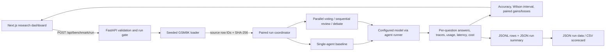
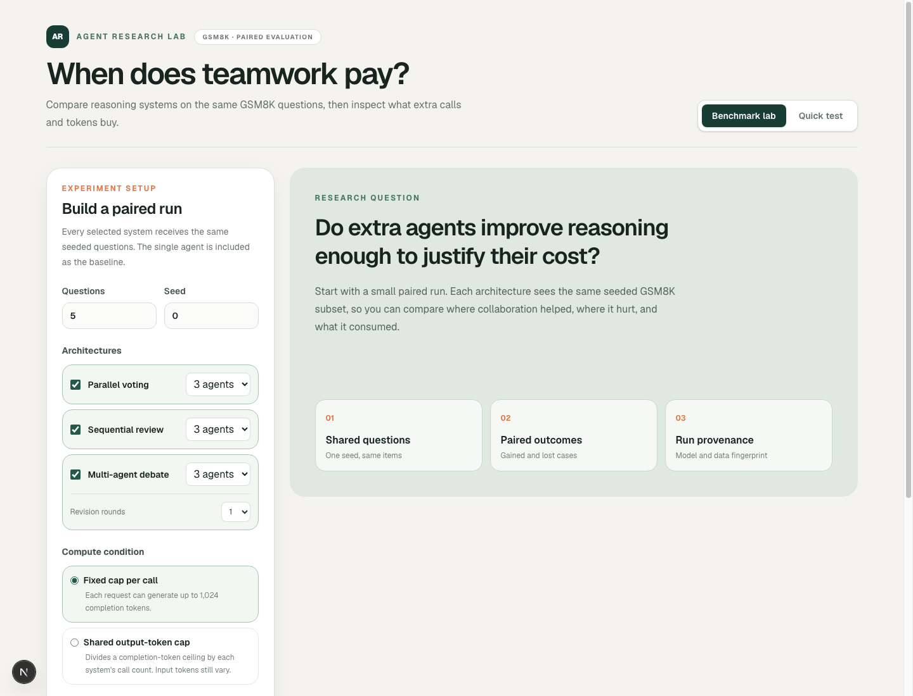

# Single-Agent vs. Multi-Agent LLM Systems: Evaluating Agentic Architectures for Reasoning Performance and Computational Efficiency

**Ahamad Mamun Nishar Miya**
Fisk University

**Advisor:** Dr. Ning Zhang
**Course:** Senior Seminar II
**Department:** Fisk University Department of Computer Science

# Progress Report 4: Weeks 8 and 9

**Reporting date:** October 20, 2026
**Repository:** [miyannishar/agent-architecture-research](https://github.com/miyannishar/agent-architecture-research)

## 1. Project Overview

This research evaluates whether multi-agent Large Language Model (LLM) architectures improve reasoning enough to justify their additional computational cost. The comparison focuses on single-agent reasoning and three collaborative approaches: parallel voting, sequential review, and multi-agent debate. The main measures are answer accuracy, model calls, input and output tokens, latency, and estimated cost.

Weeks 8–9 concentrated on making the experiment workflow more reproducible and usable. The work added a paired GSM8K benchmark flow, dataset provenance, bounded run controls, and a dashboard for configuring and inspecting comparisons. At the same time, an older pilot artifact was audited. Because the pilot’s labels and missing metadata prevent verification, its scores are not reported as research findings. The new run flow has not yet been exercised against the live model API, so this report describes implementation progress rather than experimental conclusions.

## 2. Architectural Design and Decisions

The product keeps the researcher-facing interface separate from experiment execution. The Next.js frontend collects run settings and presents results; the FastAPI backend validates the request, loads a dataset sample, invokes the selected agent architectures, computes summaries, and persists run artifacts. Agent implementations remain in the backend, while dataset loading and identity checks live in `backend/benchmarks.py`.

This separation has three practical benefits. First, it keeps model credentials and benchmark execution on the server instead of exposing them in the browser. Second, the backend can apply run limits and a server-side feature gate before any model calls are made. Third, adding a dataset loader or architecture can extend the experiment service without redesigning the dashboard’s basic configuration and result-review workflow.

The current endpoint runs a bounded interactive comparison. Larger sweeps across many questions and agent counts should use the batch runner or a future background-job workflow rather than a single long dashboard request.

### Architecture Diagram

The browser sends a configuration to the API. The backend loads one seeded set of questions, runs the baseline and selected architectures on that same set, then returns paired metrics and saves provenance-aware artifacts.



## 3. Work Completed

### Paired benchmark API

The backend now exposes `POST /api/benchmark/run`. Each request includes the single-agent baseline automatically, then runs each selected configuration against the same seeded question subset. For every question and architecture, the run records the prediction, correctness, model calls, input and output tokens, total tokens, latency, estimated cost, answer trace, and any item-level error. The endpoint returns summaries and case-level results while saving JSONL rows and a JSON summary under `backend/results/`.

The request model limits a sample to 50 questions, restricts supported agent counts and debate rounds, rejects duplicate configurations, and caps an interactive request at 120 planned model calls. The server also requires the operator to enable `ENABLE_BENCHMARK_RUNS` and configure a real model API key. Mock mode is rejected for research benchmark requests.

Representative request validation:

```python
n: int = Field(default=5, ge=1, le=50)
...
total_calls = self.n * calls
if total_calls > 120:
    raise ValueError(
        f"This run would make {total_calls} model calls; the dashboard limit is 120."
    )
```

### Dataset provenance and pairing

The GSM8K loader now retains each question’s original row index through seeded shuffling. All architectures in one request receive the same sampled questions, which supports paired comparisons and makes the saved question IDs traceable to the source dataset. The run metadata records the random seed, model name, dataset row count, and SHA-256 fingerprint of the cached GSM8K file.

```python
rows = [(i, json.loads(line)) for i, line in enumerate(path.read_text().splitlines())]
random.Random(seed).shuffle(rows)
...
"id": source_id
```

The API computes the fingerprint from the exact cached file used by the loader:

```python
digest = hashlib.sha256(path.read_bytes()).hexdigest()
return {"name": "gsm8k_test", "sha256": digest, "rows": row_count}
```

### Research dashboard

The dashboard now provides a benchmark-lab view for selecting sample size, random seed, architectures, agent counts, debate rounds, and compute condition. It estimates total calls before submission, shows the API-cost acknowledgment, and presents results with accuracy and Wilson 95% intervals, paired accuracy changes, gained and lost cases, token usage, latency, and cost.

Researchers can inspect individual cases, including each configuration’s answer and agent trace, and filter for questions where collaboration changed correctness. Run details can be downloaded as JSON, and the scorecard can be exported as CSV. The visual design was updated with a consistent research-console layout, clear control grouping, and responsive styling.

### Audit of the earlier pilot

The ignored local artifact `backend/results/gsm8k_20261006_123148.jsonl` contains 30 rows: ten each for `single_agent:1`, `parallel_voting:3`, and `debate:3`. It has no matching summary file and does not record the seed or a dataset fingerprint. All ten baseline rows have `gold=16`, while the first ten labels from the current cached GSM8K file under seed 0 are `16, 240, 80, 15, 91, 22, 8, 11, 25, 482`. This discrepancy cannot be resolved from the artifact alone. Accordingly, its accuracy and cost figures are excluded from this report’s findings pending provenance recovery.

## 4. Methods and Approaches

- **Paired sampling:** A seeded GSM8K sample is selected once per run and reused for every configuration. The single-agent result provides the baseline for paired gain and loss counts.
- **Architecture comparison:** The run automatically includes one single-agent baseline and allows parallel voting, sequential review, and debate. Supported interactive configurations use 2, 3, or 5 agents; debate rounds are configurable.
- **Compute conditions:** “Normal” mode applies a fixed maximum completion-token limit per model call. “Shared output-token cap” divides a task’s completion-token ceiling among an architecture’s calls. This does not equalize total compute: prompt length, actual token consumption, latency, and cost can still differ. The dashboard reports measured usage separately so this limitation remains visible.
- **Failure handling:** Item-level execution errors are saved separately. Failed items are not counted as incorrect answers and are excluded from paired comparisons when either system lacks a usable result.
- **Statistical summaries:** Accuracy intervals use the Wilson 95% method. Paired deltas and gained/lost counts are calculated only on questions successfully answered by both the system and baseline.

## 5. Evidence of Progress

- **Repository:** [GitHub project](https://github.com/miyannishar/agent-architecture-research)
- **Live local UI preview:** [Open the dashboard at localhost:3000](http://127.0.0.1:3000) while the local development server is running.
- **Dashboard screenshot:** [View the PNG](screenshots/benchmark-dashboard.png)



- **Implementation files:** [benchmark dashboard](../frontend/src/app/page.tsx), [dashboard styles](../frontend/src/app/globals.css), [API and run coordinator](../backend/main.py), [GSM8K loader and fingerprint](../backend/benchmarks.py), [agent architectures](../backend/agents/architectures.py), and [environment configuration](../backend/.env.example).
- **Prior progress reports:** [Week 7 report](progress_report_3.md) and [comprehensive report](progress_report_comprehensive.md).
- **Verification:** Frontend ESLint and TypeScript checks pass. `git diff --check` passes. The dashboard was opened in Chrome and visually inspected. No live model benchmark was submitted, and therefore no provider cost was incurred during UI review.

The screenshot documents the initial experiment-setup view; it is not a screenshot of benchmark results.

## 6. Challenges and Resolutions

1. **The previous pilot cannot be verified.** It lacks a seed and dataset fingerprint, and its baseline answer labels do not match the current default-seed sample. The new pipeline records original question IDs and a SHA-256 dataset fingerprint in each run so future results can be audited against their source.
2. **The shared token ceiling is not equal total compute.** Dividing an output-token cap by call count does not equalize input tokens, actual output lengths, latency, or cost. The dashboard now labels this condition precisely and reports measured input and output usage separately. The research should avoid describing the condition as fully compute-equivalent.
3. **Interactive runs must remain bounded.** A large configuration sweep can exceed reasonable request duration and cost. The endpoint’s 120-call cap makes dashboard pilots manageable; broader evaluations should be run through `backend/run_experiments.py` or a background-job service.
4. **Research runs require explicit operator setup.** Benchmarking is disabled by default. A controlled environment must set `ENABLE_BENCHMARK_RUNS=true` and provide `LLM_API_KEY` before the new API can execute real model calls.

## 7. Next Steps: Validation and Research Roadmap

1. **Run a small real-model pilot.** In a controlled environment, enable the benchmark gate and run five GSM8K questions across the baseline and selected architectures. Confirm the configured model, dataset fingerprint, seed, and planned call count before scaling up.
2. **Validate the saved artifacts.** Check that every saved question ID and gold answer corresponds to the recorded dataset fingerprint. Review error rates, missing final-answer markers, per-agent traces, usage totals, and summary calculations.
3. **Resolve the old pilot’s status.** Recover its source dataset and sampling metadata if available; otherwise document it as unverifiable and retain it outside the validated results set.
4. **Scale the GSM8K study.** Use the batch runner for the planned agent-count sweep (1, 2, 3, and 5 where supported), multiple random seeds, and both normal and output-token-cap conditions. Preserve each run’s metadata and artifacts.
5. **Analyze tradeoffs and failure cases.** Compare accuracy against calls, input/output tokens, latency, and cost. Examine cases where collaboration changes a correct baseline answer to an incorrect one, as well as cases where it recovers a baseline error.
6. **Expand dataset coverage.** After GSM8K is reproducible, add MMLU-Pro and other planned reasoning benchmarks, then report results by dataset and task category.
7. **Improve long-run operations.** If interactive requests become insufficient, add background jobs with progress tracking and durable run status rather than raising the dashboard call limit without safeguards.

## 8. Current Conclusion

Weeks 8–9 moved the project closer to its research goal by connecting the dashboard to a bounded, paired, provenance-aware GSM8K workflow. The implementation now supports experiment configuration, result inspection, and downloadable artifacts, and the UI has been reviewed in Chrome. The central research result remains open: the existing pilot is not verifiable, and the new live-model workflow has not yet produced validated measurements. The next milestone is a small real-model run followed by artifact-level verification before any larger sweep or accuracy claim.
